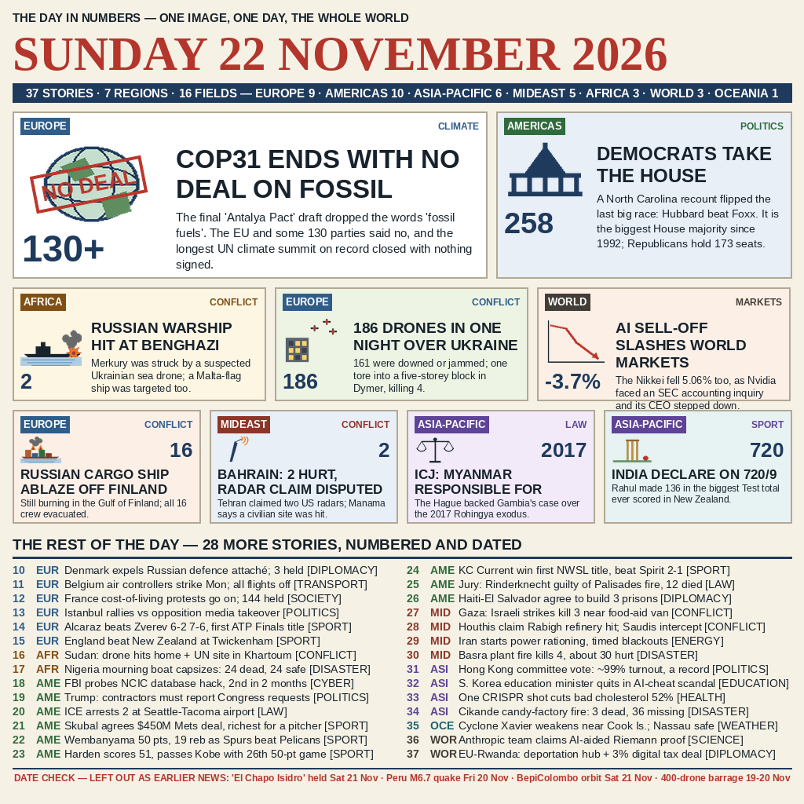

# Sunday 22 November 2026 — THE DAY IN NUMBERS: 37 dated stories, 7 regions

[](https://make.fun/bounty/news-image-20261122?utm_source=github&utm_medium=readme&utm_campaign=news-image-20261122)
[](https://make.fun/bounty/news-image-20261122/leaderboard?utm_source=github&utm_medium=readme&utm_campaign=news-image-20261122)
[](https://make.fun/bounty/news-image-20261122?utm_source=github&utm_medium=readme&utm_campaign=news-image-20261122)



One image that sums up the world's news of Sunday 22 November 2026,
built as a scoreboard: **37 stories, 7 regions, 16 fields**, and every
big story carries the number that defines it.

## How it reads

- **The date is the headline.** SUNDAY 22 NOVEMBER 2026 is the largest
  text on the page, and the navy band under it prints the day's true
  breadth — 37 stories with the count for each of the 7 regions. The
  counts are computed by the program from its own story data, so they
  cannot disagree with the page.
- **Nine scenes with their numbers baked in.** COP31 ends with no deal
  (130+ parties said no, stamped across the globe), Democrats take the
  House (258), a Russian warship is hit at Benghazi (2 ships targeted),
  186 drones in one night over Ukraine, world markets fall −3.7%,
  a Russian cargo ship ablaze off Finland (16 crew safe), Bahrain
  (2 hurt, radar claim disputed), the ICJ genocide ruling (2017), and
  India declare on 720/9.
- **The rest of the day, numbered.** 28 more stories, each one line,
  each tagged with its region and field — Denmark to Cikande, Hong
  Kong to Nassau.
- **Date check at the foot.** The famous stories that belong to other
  days are named as left out: the 'El Chapo Isidro' arrest (Sat),
  the Peru quake (Fri), BepiColombo (Sat), the 400-drone barrage
  (19–20 Nov).

Every story happened, or was first reported, on Sunday 22 November
2026, as the day's outlets reported it. Disputed claims are labelled
as claims: Tehran's radar claim is printed beside Bahrain's account.

## Reproduce

```sh
python3 render.py entry.png   # paints entry.png, 1024x1024, deterministic
python3 main.py               # copies entry.png to $MAKEFUN_OUTPUT_DIR
```

`render.py` draws everything procedurally with Pillow (Liberation
Serif / Liberation Sans, SIL OFL). No external assets, no network, no
randomness: two runs write byte-identical PNGs.

## License

MIT — see LICENSE.
